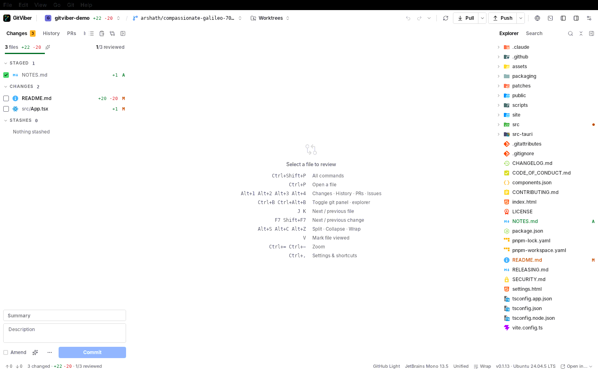
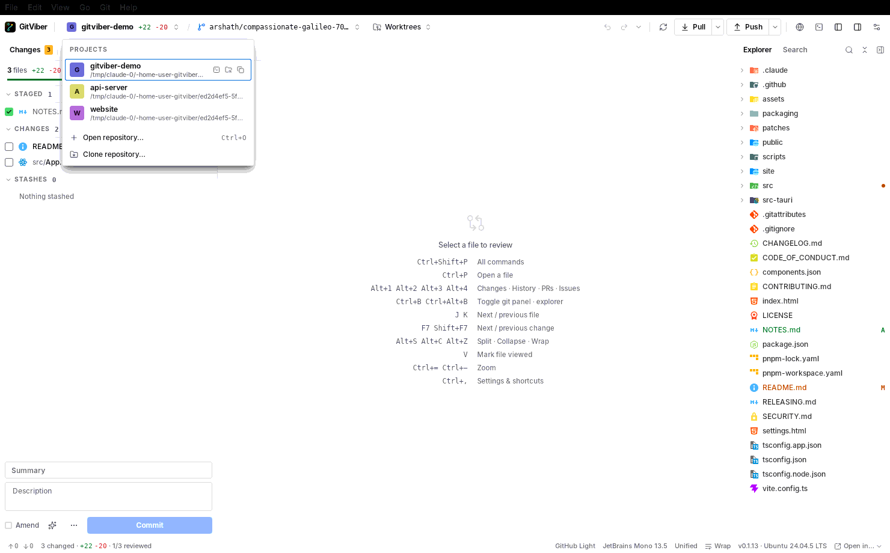
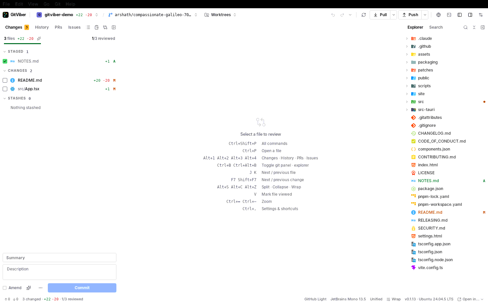
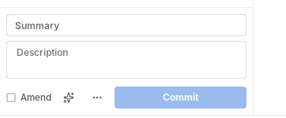
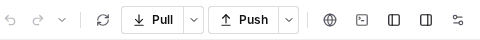
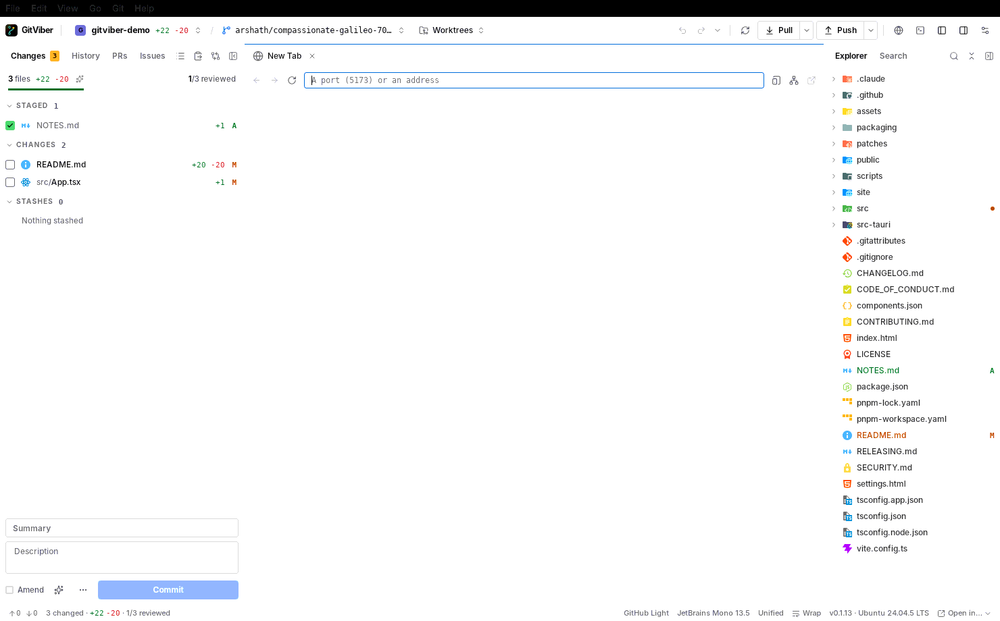
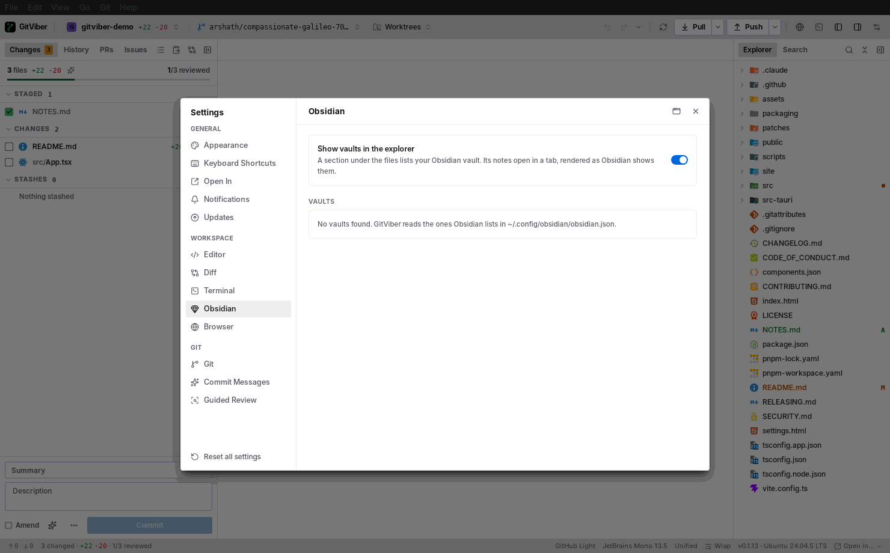
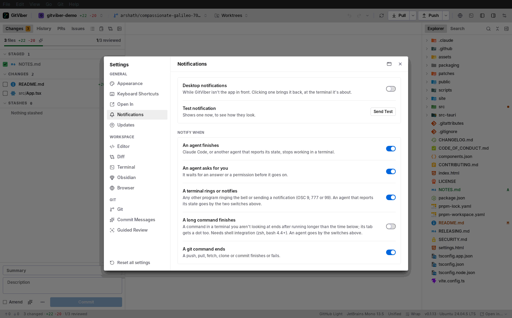
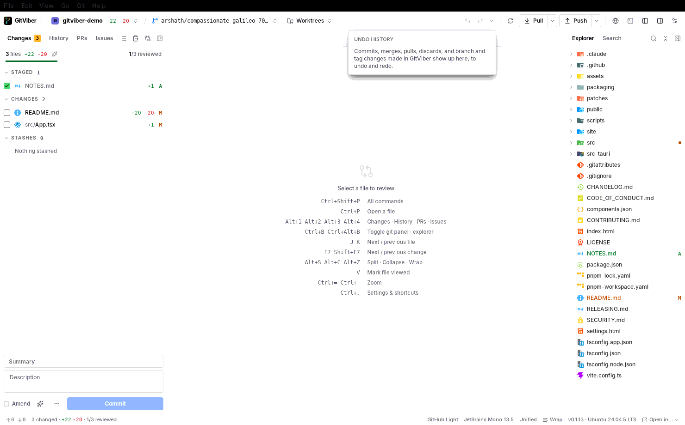
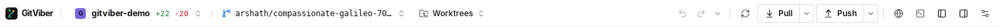

# GitViber fork: work plan

What this fork changes compared to upstream GitViber (0.1.13, commit `5e0a3e8`). The goal is
a smaller app for personal use, built locally and installed through your own Homebrew tap.

Screenshots of the current UI (Linux dev build under Xvfb) are in [`docs/fork-plan/`](docs/fork-plan/),
referenced below where relevant. A 45-second walkthrough of everything listed here is in
[`docs/fork-plan/walkthrough.mp4`](docs/fork-plan/walkthrough.mp4): the repo popover, the PRs and
Issues tabs, Undo history, a Browser tab, and the Obsidian, Notifications and Browser settings.

---

## 0. Where things are today



The window (`src/features/workspace/Workspace.tsx`) is laid out like this:

```
┌───────────────────────────── TopBar ─────────────────────────────────────────┐
│ Logo │ ProjectSwitcher ▾ / BranchPicker ▾  WorktreePicker │ … │ Undo Redo ▾ │
│      Fetch  Pull▾  Push▾ │ Agents  Browser  Terminal  ◧ ◨  Settings          │
├──────────── LEFT "list" panel ────┬──── viewer ────┬──── RIGHT "files" ───────┤
│ Changes │ History │ PRs │ Issues   │  TabStrip      │ Explorer │ Search        │
│ [view-menu] [apply-patch] [review] │  Monaco / PR / │ [filter] [collapse]       │
│ …rows…                             │  Browser / …   │ FileTree                  │
│ ── CommitBox (bottom of Changes) ──│                │ ── Obsidian vault ──      │
│                                    ├── Terminal ────┤                           │
└────────────────────────────────────┴────────────────┴───────────────────────────┘
                                   StatusBar
```

* The **left sidebar** (`id="list"`, `data-panel="git"`) holds the `ListTab`s
  `changes | history | pulls | issues`.
* The **right sidebar** (`id="files"`, `data-panel="explorer"`) holds `files | search`
  (`explorerView`), plus the Obsidian vault section (`ExplorerPanes`).
* Both are fixed-pixel panels managed by `usePanelSizes("gitviber-sides-v1", …)` with the
  `SIDES` constant `{ list, files }`.
* The repo picker is `ProjectSwitcher` (`src/features/topbar/ProjectSwitcher.tsx`). It is a
  popover that wraps the reusable `ProjectList` (`src/features/projects/ProjectList.tsx`), so
  switching repos takes two clicks.
* Switching repos remounts `<Workspace key={opened.root}>` (`src/App.tsx:208`). Any
  sidebar-level repo list therefore only has to call `onOpenRepo(path)`.

Baseline checks on this branch before any change: `pnpm typecheck` passes, `pnpm test`
passes 730/730, and the Linux debug build compiles and runs (see §7).

---

## 1. Move the repo picker from the top bar to the sidebar (one-click switch)



**Target:** a "Repositories" section at the top of the merged sidebar (§2). It shows the
recent repos as rows. One click opens a repo, the current one is highlighted, and the section
keeps the existing drag-to-reorder, right-click menu, and "Open…" / "Clone…" actions.

| Step | File(s) | Notes |
|---|---|---|
| 1.1 | new `src/features/workspace/RepoSection.tsx` | Wraps `ProjectList` (already exported and self-contained) with a collapsible header (`Repositories`, `+` open, clone), similar to `VaultSection`'s collapsible header. Persist the collapsed state and height in `localStorage` (pattern in `VaultSection.tsx:24-29`). |
| 1.2 | `ProjectList.tsx` | Add a `compact` prop: 24px rows, no path subtitle. The current branch and dirty counts come from `api.projectInfo` and are already fetched. |
| 1.3 | `src/features/topbar/TopBar.tsx` | Remove `<ProjectSwitcher>` and the `/` separator. Keep `BranchPicker` and `WorktreePicker` in the top bar. |
| 1.4 | `ProjectSwitcher.tsx` | Keep only the `file.switchProject` command, now focusing the sidebar's repo list, or delete the file and drop the command from `src/lib/commands/commands.ts`. |
| 1.5 | `Workspace.tsx` | Pass `recent / onOpenRepo / onForgetRepo / onReorderRepos / onLocateRepo` to the sidebar instead of `TopBar`. |

Inside the sidebar, the repo list sits in a vertical `ResizablePanelGroup` above the view
tabs, so it can be dragged smaller or collapsed to its header.

---

## 2. One merged sidebar: Explorer, Search, Changes, History, dockable left or right


**Target layout:**

```
┌──────────── TopBar ───────────────────────────────────────────────────────┐
│ Logo │ BranchPicker ▾ WorktreePicker │ …  │ Fetch Pull▾ Push▾ │ Agents Terminal ◧ ⚙ │
├──── Sidebar (left OR right) ─┬──────────── viewer ─────────────────────────┤
│ REPOSITORIES            + ⤓ │  TabStrip                                    │
│ ● gitviber      +12 -3      │  Monaco …                                    │
│   other-repo                │                                              │
│ ─────────────────────────── │                                              │
│ Explorer Search Changes Hist│                                              │
│ …active view…               ├──────────── Terminal ────────────────────────┤
└─────────────────────────────┴──────────────────────────────────────────────┘
```

| Step | File(s) | Notes |
|---|---|---|
| 2.1 | `Workspace.tsx` | Replace `LIST_TABS` and `explorerView` with one `SidebarView = "explorer" \| "search" \| "changes" \| "history"`. Restore it from `saved.listTab` and map the old values: `pulls`/`issues` become `changes`, an unknown value becomes `explorer`. |
| 2.2 | `Workspace.tsx` | `SIDES` becomes `{ side: { base: 300, min: 220, max: "45", collapsible: true } }`, with a new storage key `gitviber-side-v1`. Render one `ResizablePanel id="side"` either before or after `id="viewer"`, depending on the setting. Keep the `KeptPanel`s and the always-mounted `SearchView`/`FileTree`, so state survives tab switches as it does today. |
| 2.3 | `src/lib/settings.ts` | Add `sidebarSide: "left" \| "right"` (default `"left"`), with validation in the loader like the other enums (around line 450). |
| 2.4 | `src/features/settings/sections/Appearance.tsx` | Add a `Segmented` "Sidebar position: Left / Right" control. |
| 2.5 | `src/lib/commands/commands.ts` + `src-tauri/src/menu.rs` | Commands: `view.toggleSidebar` (⌘B, replacing `toggleGitPanel`/`toggleExplorer`), `view.moveSidebar` ("Move Sidebar Left/Right"), and `view.explorer/search/changes/history` on ctrl+1..4, replacing `view.pulls`/`view.issues`. Update the View menu in `menu.rs` (lines ~185-200). |
| 2.6 | `src/lib/ui/panels.ts` | Keep the `git` and `explorer` focus targets as `data-panel` attributes on the inner views (Changes/History are `git`; Explorer/Search are `explorer`), so F6, Esc-back-to-list and `focusPanel` keep working. Make `PANELS` skip whichever one is hidden. |
| 2.7 | `src/features/workspace/PanelHeader.tsx` | One `CollapseButton` whose icon flips with the dock side. In `TopBar` the two ◧ ◨ buttons become one sidebar toggle. |
| 2.8 | Revealers in `Workspace.tsx` | `revealInExplorer`, `search.findInFiles`, `showInHistory`, `changes.focusMessage` and the others currently expand `"list"` or `"files"`. Point them at `"side"` and switch the view. |
| 2.9 | `src/lib/repo/session.ts` | Keep the `listTab` key name for compatibility, but store the new view value. |

The Obsidian vault section currently sits under the file tree (`ExplorerPanes`). It goes away
with §3.

---

## 3. Remove features

Each one starts with an **A (UI removal)**: unhook it from the UI and commands. That is small,
low risk, and easy to keep merging from upstream. **B (dead-code removal)** then deletes
modules, Rust commands and dependencies. B makes the app smaller, but every upstream merge
touching those files will conflict. My recommendation: A for everything, plus B for Browser,
Obsidian and Notifications (self-contained and large).

### 3.1 PRs and Issues tabs



* **A:** drop the `pulls` and `issues` tabs and `KeptPanel`s from `Workspace.tsx:514-519,
  571-588`, the `view.pulls`/`view.issues` commands and menu items, and the `PullsPanel` and
  `IssuesPanel` imports.
* **Keep** (used elsewhere, and harmless): `features/github/*` view code for PR tabs opened from
  terminal links and the worktree picker's PR badges, `CiBadge`, `CommitChecks`, and the
  `github/` Rust module.
* **B (optional):** remove the `kind: "pull" | "issue" | "pr-file"` selections (`selection.ts`),
  the matching branches in `Viewer.tsx`/`TabStrip.tsx`/`useTabs.ts`, `useWorktreePulls`, and the
  terminal link → PR routing in `lib/links/`. This touches about 25 files, so it is not
  recommended unless you want GitHub gone completely.

### 3.2 Commit box at the bottom of Changes



* **A:** in `src/features/changes/ChangesPanel.tsx:694-701`, remove the `CommitBox` (and the
  "operation in progress" footer, or keep that one line as a hint). Drop
  `changes.focusMessage` (`commands.ts:46`, `Workspace.tsx:382`).
* Keep `useCommitBox.ts`/`CommitBox.tsx` only if something else imports them (`grep` shows only
  ChangesPanel and Workspace do), and delete them in B. Settings → **Commit** (sign-off,
  co-authors, AI suggest) then has no effect, so remove that section too
  (`SettingsPanel.tsx:12,112`).
* Staging, discard, stash, and review/viewed marks stay. Commit from the terminal or agent.

### 3.3 Browser




* **A:** `TopBar.tsx` `BrowserButton`; `Workspace.tsx` `openPage`, `usePageAsk`,
  `browser.open`/`browser.clearData`, `useAgentTabs`; `Viewer.tsx:103-104`; all `browser.*`
  commands (`commands.ts:166-185`) and the menu item (`menu.rs:199`); the Settings → Browser
  section; the terminal's "open port" menu (`PaneLayout.tsx:34-36`, `PortsMenu`).
* **B:** delete `src/features/browser/`, `src/lib/browser/`, `src/lib/api/browser.ts`, the
  `kind: "browser"` selection and its session restore, Rust `src-tauri/src/browser/` (~5k lines,
  including macOS WKWebView code), `commands/browser.rs`, its 21 registrations in `lib.rs`
  (`447-467`), the `gitviber browser …` CLI hook in `main.rs`/`lib.rs:83-87`, the CSP
  `frame-src` entry, and the `browser` ask kind in `QuestionBox.tsx`. Terminal URL clicks then
  open in the system browser (`linkHost.ts` already has that fallback).

### 3.4 Obsidian



* **A:** in `Workspace.tsx`, render `FileTree` directly instead of `ExplorerPanes`. Remove the
  Settings → Obsidian section and the `vault` branch in `Viewer.tsx:101-102`.
* **B:** delete `src/features/obsidian/`, `src/lib/obsidian/`, `src/lib/api/obsidian.ts`, the
  `kind: "vault"` selection, the `obsidian`/`hiddenVaults` settings, Rust `obsidian.rs` and
  `commands/obsidian.rs` (9 registrations, `lib.rs:337-345`). Careful: `lib/markdown/syntax.ts`,
  `viewer/markdown/Callout.tsx` and `Properties.tsx` support Obsidian-style markdown for **all**
  markdown files, so leave those alone.

### 3.5 Notifications



* **A:** remove the Settings → Notifications section. With `notify` defaulting to `false`,
  nothing is ever posted.
* **B:** make `notifyIfAway` a no-op (it is called from `lib/terminal/needsYou.ts` and
  `lib/repo/netActivity.ts`), delete `lib/app/notify.ts`, `notifyState.ts` and its test, and
  Rust `notifications.rs` plus its 4 commands (`lib.rs:206-209`) and `setup` (`lib.rs:185`).
  Drop the `tauri-plugin-notification` crate (`Cargo.toml`, `lib.rs:112`) and its permission in
  `capabilities/*.json`. Keep the in-app terminal dots and the Dock badge: those are not
  notifications.

### 3.6 Apply Patch from Clipboard

* **A:** remove the `ClipboardPaste` button (`Workspace.tsx:524-534`), `<ApplyPatchDialog>`
  (`:754`), the `git.applyPatch` command (`commands.ts:202`, `Workspace.tsx:344`).
* **B:** delete `ApplyPatchDialog.tsx`. In Rust, remove only `commands::patch::patch_preview` and
  `apply_patch` and their scenario tests (`scenario_tests/patch_edges.rs`, check which tests
  cover apply). Keep the other `patch.rs` functions: they power stash, discard lines and
  revert.

### 3.7 Undo history




* **A (recommended reading of the request):** remove `<UndoControls>` from `TopBar.tsx`
  (the ↶ ↷ buttons and the ▾ "Undo history" dropdown).
* **Decision needed:** the journal behind it (`src-tauri/src/journal.rs`, `lib/repo/undo.ts`) also
  powers the **Undo** button on toasts ("Discarded 3 files · Undo") and ⌘Z / ⇧⌘Z. Options:
  1. Remove only the top-bar controls. Toast Undo and ⌘Z keep working. *(Recommended: discard
     with undo is a safety net.)*
  2. Also remove ⌘Z/⇧⌘Z (`git.undo/redo` in `commands.ts:204-205`, `menu.rs:260-261`), keeping
     toast Undo.
  3. Remove the journal entirely. This touches about 15 files (`useGitAction`, `StashList`,
     `FileTree`, `CommitFileMenu`, …), and discard would become permanent.

---

## 4. Top bar after the changes



Remaining: Logo · BranchPicker · WorktreePicker · "Not published" · *(activity)* · Fetch ·
Pull ▾ · Push ▾ · Agents · Terminal · Sidebar toggle · Settings.

---

## 5. Making it yours for a Homebrew tap

These are not UI changes, but they are needed so the fork doesn't fight upstream:

1. **Updater.** This one is critical. `tauri.conf.json:58-61` points at upstream's
   `latest.json`. As is, your build would offer the upstream release and replace your fork.
   Either remove the updater (`tauri-plugin-updater`, `src/lib/app/updates.ts`,
   Settings → Updates, `UpdateButton` in the status bar) or point `endpoints` and `pubkey` at
   your own releases. Removing it is simpler: `brew upgrade` handles updates. Then set
   `auto_updates false` in the cask.
2. **Identifier and name.** To install next to upstream (or to avoid sharing its
   `~/Library/WebKit/app.gitviber.desktop` localStorage/settings), change `identifier` in
   `tauri.conf.json` (e.g. `io.<you>.gitviber`) and optionally `productName`. Update the cask's
   `app`/`zap` paths to match.
3. **Cask.** Copy `packaging/homebrew/gitviber.rb` to your tap (`<you>/homebrew-tap`,
   `Casks/gitviber.rb`) and point `url` and `homepage` at your fork's releases.
   `.github/workflows/homebrew.yml` can do this automatically if you add a `HOMEBREW_TAP_KEY`
   deploy key, as `RELEASING.md` describes.
4. **Signing.** `release.yml` needs Apple Developer and Tauri signing secrets. Without them, the
   simplest route is a local `pnpm tauri build --bundles dmg` (or `--target
   universal-apple-darwin`), uploaded to a GitHub release. The cask can then de-quarantine the
   unsigned app (`postflight { system_command "xattr", args: ["-dr", "com.apple.quarantine", "#{appdir}/GitViber.app"] }`),
   or install with `brew install --cask --no-quarantine`. `pnpm install:mac` already builds and
   copies a local `.app` for quick personal use.
5. **Links.** Point About and README links, `homepage`, and the `bundle.publisher` at your fork,
   as you like.

---

## 6. Suggested order of work (one commit each)

1. Remove features, A level (§3.1–3.7). Typecheck and tests after each.
2. Merge the sidebars (§2), including the dock setting.
3. Repo list in the sidebar (§1).
4. B-level dead-code removal (Browser, Obsidian, Notifications, ApplyPatch).
5. Updater, identifier and cask (§5).
6. Update `README.md` and `CHANGELOG.md` for the fork.

Checks for every step: `pnpm typecheck && pnpm test && pnpm check:rust`, then a run of the
Linux dev build under Xvfb with screenshots (§7).

---

## 7. Build and verify environment (Linux, used for this plan)

```sh
# system packages (Ubuntu 24.04)
apt-get install -y libwebkit2gtk-4.1-dev libgtk-3-dev libayatana-appindicator3-dev \
  librsvg2-dev libsoup-3.0-dev patchelf xvfb xdotool imagemagick ffmpeg
pnpm install --frozen-lockfile
pnpm typecheck && pnpm test          # 730/730 pass on the baseline
(cd src-tauri && cargo build)        # debug build (~4.5 min cold)
# or the system packages + pnpm install in one go: scripts/setup-linux-env.sh
# run headless and drive it
Xvfb :99 -screen 0 1480x920x24 &
DISPLAY=:99 pnpm tauri dev
```

Debug builds expose `src-tauri/src/dev_bridge.rs` on `127.0.0.1:1520`, which runs JavaScript in
the page. Together with `xdotool`, `import` (screenshots) and `ffmpeg -f x11grab` (video),
this drives the real window on Linux. That is how the screenshots in `docs/fork-plan/` were
taken.
