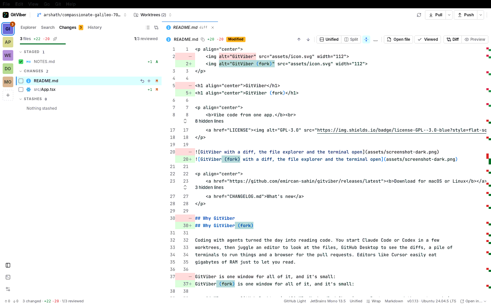

<p align="center">
  
</p>

<h1 align="center">GitViber (fork)</h1>

<p align="center">
  A personal, macOS-only fork of <a href="https://github.com/emircan-sahin/gitviber">GitViber</a>,
  trimmed to reviewing what coding agents write and working with git.
</p>



## What's here

- **A repository rail** at the window's edge: one click switches repository, the open one shows its
  changed-file count, and its foot holds the sidebar, terminal and Settings toggles. **+** opens one.
- **One sidebar** with Explorer, Search, Changes and History (`⌃1`–`⌃4`), docked left or right
  (`⌥⌘B`, or Settings → Appearance), shown and hidden with `⌘B`.
- **Live diffs** of uncommitted, staged, branch and commit changes; stage, unstage or discard
  single lines; conflict resolution.
- **History**: the commit graph, rewriting the branch (reword, squash, drop, reorder), reset,
  revert, cherry-pick, reflog and bisect.
- **Branches, worktrees, stashes, compare, fetch, pull and push.**
- **Review**: notes on lines sent to the terminal or copied as a prompt, viewed files, and a
  guided review written by your agent CLI (Settings → Agent): sections in reading order, a file tree, a sketch of the change and its merge danger (one- or two-way door, blast radius).
- **A terminal** with tabs and splits under the code.

What this fork removed, and why, is in [FORK_PLAN.md](FORK_PLAN.md) and the [changelog](CHANGELOG.md).

## Install

```sh
brew trust --cask itizarsa/tap/gitviber
brew install --cask itizarsa/tap/gitviber
```

Universal (Apple silicon and Intel), macOS 13 or newer. It's self-signed rather than notarized;
the cask clears the quarantine flag so it opens without a Gatekeeper prompt. There's no in-app
updater: `brew upgrade --cask itizarsa/tap/gitviber`.

It needs git 2.36 or newer (`xcode-select --install` or `brew install git`).

## Build from source

Rust (stable), Node 22+, pnpm and git:

```sh
pnpm install
pnpm tauri dev      # run it
pnpm install:mac    # build a release and copy it into /Applications
pnpm check          # what CI runs: build, tests, rustfmt, clippy, cargo test
```

A `v*` tag builds, signs and publishes a release (`.github/workflows/release.yml`); the cask in
[itizarsa/homebrew-tap](https://github.com/itizarsa/homebrew-tap) then gets the new version and
SHA-256.

## License

[GPL-3.0](LICENSE), as upstream. GitViber is by [Emircan Sahin](https://github.com/emircan-sahin/gitviber).
